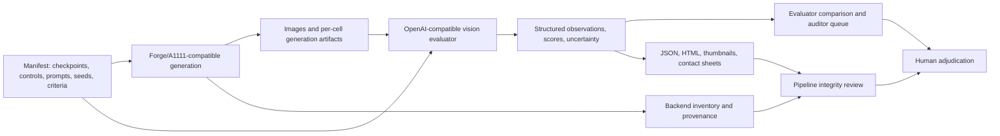

# Architecture

CEF separates experimental specification, image generation, visual observation, aggregation, and human review so that each stage leaves inspectable evidence.

## Components

`models.py` and `manifest.py` convert JSON or YAML manifests into typed suites. A suite is the Cartesian product of checkpoints, LoRA profiles, and tests. Each test can override generation settings and provide criteria, references, purpose, category, and metadata.

`forge.py` is the current image-backend adapter. It targets the Forge/A1111 REST surface, including options, model inventory, LoRA inventory, version metadata, and `txt2img`. The adapter boundary is small, but other image APIs are not yet implemented.

`generation.py` materializes each suite cell. It snapshots the manifest, records backend inventory, writes request and criteria artifacts, saves images and response metadata, and maintains an atomic incremental index. Resume mode validates the manifest and reuses only complete cells.

`analysis_client.py` talks to OpenAI-compatible chat-completions endpoints with image input. `analysis.py` supplies the run-local generation record, criteria, evaluator directive, and optional references, then preserves normalized output and raw response material.

The style, semantic, and basin observer modules support score-free specialist observation. Evaluator comparison and observer qualification keep distinct roles visible instead of collapsing all model judgments into a single score.

`reporting.py` produces the human-facing report and optional Pillow contact sheet. `provenance.py` conservatively extracts Forge/A1111 PNG metadata while retaining raw text when parsing is incomplete. `dossier.py` aggregates multiple suites into a checkpoint-level behavioral dossier.

`cef-review-run` builds a cross-stage dashboard covering generation, provenance, observation, extraction, aggregation, routing, and human review.

## Provider boundaries

- Image generation: Forge/A1111-compatible today; other providers require a new adapter.
- Vision evaluation: any endpoint compatible with the supported OpenAI chat-completions image-message shape, subject to model-specific response-format behavior.
- Reporting: local static files; no database or hosted service is required.

## Deliberate design choices

- A run-local manifest prevents later source edits from rewriting experimental history.
- Generated data remains outside version control until deliberately curated.
- Generation and evaluation can run in separate sessions for constrained VRAM.
- Raw evaluator responses and failure records remain available for audit.
- Human judgment is an explicit terminal layer, not something automated scoring pretends to replace.
